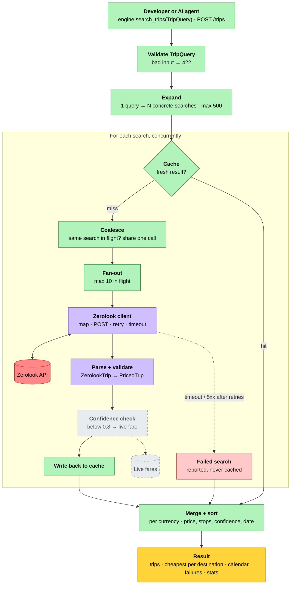

# Flightkit

Python SDK that orchestrates flight-price APIs (starting with [Zerolook](https://www.zerolook.ai/)):
fan-out (one request → many concurrent searches), caching, and a confidence-based fallback to live fares.

Unofficial — not affiliated with Zerolook.

## How a search flows



Green: core (pure orchestration) · purple: Zerolook adapter · red: external API ·
dashed grey: planned, waiting on Zerolook's API docs.

## Install

```bash
pip install flightkit            # library only (httpx + pydantic)
pip install "flightkit[api]"     # + FastAPI wrapper
pip install "flightkit[mcp]"     # + MCP server
pip install "flightkit[all]"     # everything
```

## Layout

```
src/flightkit/
  core/         pure logic — no I/O, no FastAPI, no adapters imports
  adapters/     implementations of core ports that call external services
  entrypoints/  optional doors (FastAPI, MCP) that call into core
```

Dependencies point inward: `entrypoints → core ← adapters`. `tests/test_architecture.py` enforces it.

## Development

```bash
uv sync                  # base install + dev tools (no extras)
uv sync --extra all      # with FastAPI + MCP
uv run pytest -v
uv run ruff check . && uv run ruff format .
uv run mypy
uv build                 # sdist + wheel into dist/
```

Pre-commit hooks: `uv run pre-commit install` once per clone.
