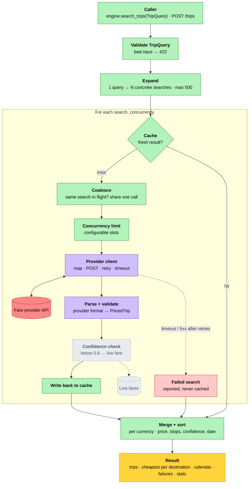

# flightkit

[](https://github.com/Angelos-Zaimis/flightkit/actions/workflows/ci.yml)


[](LICENSE)

An async Python SDK for searching flight prices at scale.

A single question like *"Athens or Crete, leaving some time in the first half of June, for about a
week"* turns into dozens of concrete searches against a fare provider. flightkit handles that
part. It expands the query, runs the searches concurrently within a limit, avoids paying for the
same search twice, survives provider errors, and returns the results ranked.

It's aimed at callers that generate a lot of search traffic, like booking backends, metasearch
services and AI agents, where cost per query and rate limits matter more than any single request.

> **Status:** early development, not yet published to PyPI. The first provider adapter targets
> the Zerolook API; its request and response fields are placeholders until the API is publicly
> documented.

## Features

- **Flexible trip queries.** Several destinations, a departure window and a range of nights,
  validated up front with clear errors.
- **Bounded fan-out.** Searches run concurrently under a configurable limit shared by every
  request on the engine.
- **Caching.** In-memory cache keyed by search, with a TTL and LRU eviction.
- **Request coalescing.** Identical searches that are already in flight share one provider call.
- **Retries.** Network errors, 429 and 5xx responses are retried with exponential backoff and
  jitter; `Retry-After` is honoured.
- **Partial results.** A failed search is reported alongside the results instead of failing the
  whole request.
- **Ranked output.** Trips sorted per currency, with the cheapest option per destination and a
  cheapest-per-day calendar.
- **Per-request stats.** Searches, cache hits, coalesced searches, provider calls and failures.
- **Provider-agnostic core.** The engine depends on a small `FareSource` protocol; providers
  plug in as adapters.
- **Optional HTTP API.** A FastAPI app for running flightkit as a service.

## How a search flows



Green: core · purple: provider adapter · red: external API · dashed grey: planned.

## Installation

flightkit isn't on PyPI yet. Install it from source:

```bash
git clone https://github.com/Angelos-Zaimis/flightkit.git
cd flightkit
uv sync                  # library + dev tools
uv sync --extra api      # add the FastAPI app
```

The library itself depends only on `httpx` and `pydantic`. The HTTP API (`api`) and the MCP
server (`mcp`, in progress) are optional extras.

## Try it without an API key

```bash
uv run examples/demo.py
```

The demo runs the real client and engine against a simulated Zerolook API that lives in memory,
with realistic prices and the occasional 429 or 503 thrown in. It walks through a flexible
search, a repeat served from the cache, 20 concurrent callers asking the same thing, and a query
that's too big. Abridged output:

```
1. Flexible search
   ZRH → ATH, HER, JTR · Jun 1–14 · 6–8 nights
   126 searches in 1.5s · 126 provider calls · 13 temporary errors retried · 0 failed

   Cheapest per destination
     HER  €  83.93   Tue Jun 08 → Jun 16   2 stops  conf 0.90
     ATH  €  98.39   Tue Jun 01 → Jun 09   2 stops  conf 0.82
     JTR  € 174.47   Tue Jun 08 → Jun 14   2 stops  conf 0.78

2. The same search again
   126 cache hits · 0 provider requests · 4 ms

3. 20 agents ask at the same moment
   20 × 126 = 2520 searches requested · 126 provider calls

4. A query that's too big
   refused: query expands to 1440 searches, limit is 500 · 0 provider requests
```

Add `--calm` to turn the simulated errors off.

## Quickstart

```python
import asyncio
from datetime import date

from flightkit import Engine, MemoryCache, TripQuery, ZerolookClient


async def main() -> None:
    query = TripQuery(
        origin="ZRH",
        destinations=("ATH", "HER"),
        depart_from=date(2027, 6, 1),
        depart_to=date(2027, 6, 14),
        min_nights=6,
        max_nights=8,
    )

    async with ZerolookClient(base_url="https://...", api_key="...") as source:
        engine = Engine(source, cache=MemoryCache(ttl=300), max_concurrency=20)
        result = await engine.search_trips(query)

    for destination, trip in result.currencies["EUR"].cheapest_by_destination.items():
        print(destination, trip.price.amount, trip.search.depart_date, trip.deeplink)
    print(result.stats)


asyncio.run(main())
```

That query covers 2 destinations × 14 departure days × 3 stay lengths, i.e. 84 searches:

```
ATH 98.50 2027-06-01 https://...
HER 98.50 2027-06-01 https://...
searches=84 cache_hits=0 coalesced=0 calls=84 failures=0
```

Calling `search_trips` again on the same engine within the TTL is served from the cache
(`cache_hits=84 calls=0`).

## Running the HTTP API

```bash
export ZEROLOOK_BASE_URL=https://...    # defaults to http://localhost:9000
export ZEROLOOK_API_KEY=...
uv run --extra api uvicorn flightkit.entrypoints.api:app --port 8001
```

Interactive docs are at `http://localhost:8001/docs`.

```bash
curl -X POST localhost:8001/trips -H 'content-type: application/json' -d '{
  "origin": "ZRH",
  "destinations": ["ATH", "HER"],
  "depart_from": "2027-06-01",
  "depart_to": "2027-06-14",
  "min_nights": 7,
  "max_nights": 7
}'
```

| Endpoint | Body | Returns |
|---|---|---|
| `POST /trips` | `TripQuery` | `TripResult`: ranked trips per currency, failures, stats |
| `POST /search` | list of `Search` | `SearchResult`: raw trips, failures, stats |

Invalid input and queries that would exceed the search limit return `422` before any provider
call is made.

For local development without provider access, `scripts/fake_zerolook.py` serves the same
simulated prices over HTTP on port 9000:

```bash
uv run --with fastapi --with uvicorn python scripts/fake_zerolook.py
```

## Testing your own code

`FakeZerolook` plugs into the client as an httpx transport, so you can test code that uses
flightkit without a network or an API key:

```python
from flightkit.adapters.zerolook import FakeZerolook, ZerolookClient

fake = FakeZerolook(chaos=False)
client = ZerolookClient("https://zerolook.test", "any-key", transport=fake.transport())
```

The same search always returns the same prices. With `chaos=True` some requests fail with 429 or
503, which is useful for checking how your code handles partial results.

## Configuration

| Setting | Default | |
|---|---|---|
| `Engine(max_concurrency=)` | 10 | Provider calls in flight at once, shared across requests |
| `Engine(max_searches=)` | 500 | Upper bound on searches one `TripQuery` may expand into |
| `Engine(cache=)` | none | Any `Cache` implementation, e.g. `MemoryCache` |
| `MemoryCache(ttl=)` | 300 s | How long a result stays fresh |
| `MemoryCache(max_entries=)` | 10 000 | Least recently used entries are evicted beyond this |
| `ZerolookClient(timeout=)` | 10 s | Per request |
| `ZerolookClient(max_retries=)` | 2 | Retries after the first attempt |
| `ZerolookClient(backoff=)` | 0.5 s | Base for exponential backoff (capped at 10 s) |
| `ZerolookClient(max_connections=)` | 10 | HTTP connection pool size |

`TripQuery` accepts up to 20 destinations, a departure window of up to 60 days, stays of 1–30
nights and 1–9 passengers.

## Design

```
src/flightkit/
  models.py     domain models (Search, TripQuery, PricedTrip, results)
  core/         engine, expand, rank, cache (pure logic, no I/O)
  adapters/     provider integrations implementing the core's ports
  entrypoints/  optional HTTP (FastAPI) and MCP front ends
```

Dependencies point inward: entrypoints and adapters depend on the core, never the other way
round. The core talks to providers through two protocols in `core/ports.py`, `FareSource` and
`Cache`, which keeps it testable without a network and lets new providers plug in without
touching the engine. `tests/test_architecture.py` enforces these rules.

Provider responses are parsed into a provider-specific wire model first and mapped onto
flightkit's own models, so changes on the provider side stay inside the adapter.

## Development

```bash
uv sync --extra all
uv run pytest
uv run ruff check . && uv run ruff format .
uv run mypy
uv run pre-commit install   # once per clone
```

CI runs the test suite on Python 3.10–3.13, once with the base install and once with all extras,
plus mypy, ruff, pip-audit and a package build.

## Roadmap

- [x] Concurrent search engine with caching, coalescing, retries and partial results
- [x] Flexible trip queries and ranked results
- [x] FastAPI service
- [ ] Coarse-to-fine search: sample the date range first, then refine around the cheapest and
      least certain prices
- [ ] Fallback to live fares for low-confidence predictions
- [ ] MCP server, so AI agents can call `search_trips` as a tool
- [ ] Benchmarks against exhaustive search
- [x] Top-level public API
- [ ] PyPI release

## License

MIT. See [LICENSE](LICENSE). Release notes are in [CHANGELOG.md](CHANGELOG.md).

## Disclaimer

flightkit is an independent project and is not affiliated with, endorsed by or sponsored by
Zerolook. Product names are trademarks of their respective owners and are used only to identify
compatible services.
